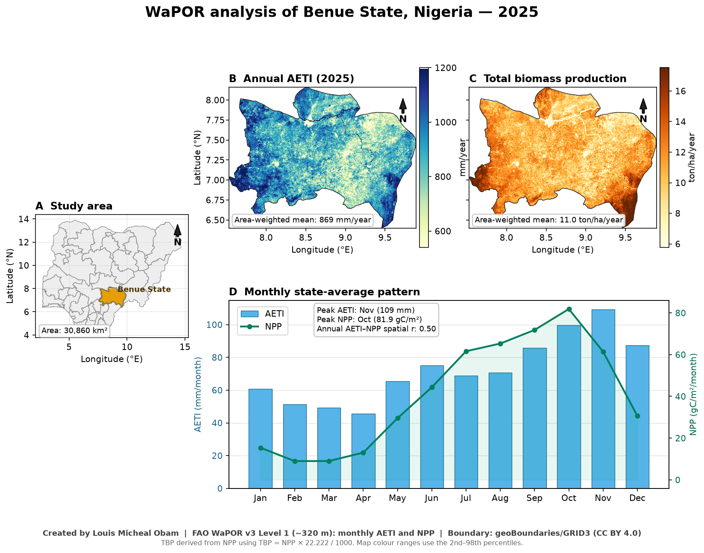

# WaPOR analysis of AETI and biomass production in Benue State, Nigeria (2025)

Created by **Louis Micheal Obam**.

This repository contains a Python-based WaPOR analysis of Benue State in north-central Nigeria. The analysis uses the latest complete calendar year, **2025**, and summarizes actual evapotranspiration and vegetation production at state scale.

## Study area

- **Area:** Benue State, Nigeria
- **Area covered:** approximately 30,860 km²
- **Boundary source:** geoBoundaries / GRID3 Nigeria ADM1 boundary, CC BY 4.0
- **Boundary file in this repo:** `Benue_State.geojson`

## Data layers

- FAO WaPOR v3 **Level 1 monthly AETI** (`L1-AETI-M`), units: mm/month
- FAO WaPOR v3 **Level 1 monthly NPP** (`L1-NPP-M`), units: gC/m²/month
- Benue State administrative boundary (`Benue_State.geojson`)

Total biomass production (TBP) was derived from NPP using the course formula:

```text
TBP = NPP × 22.222 / 1000
```

## Method

The Python workflow:

1. Clips 12 monthly WaPOR AETI and NPP rasters to the Benue State boundary.
2. Removes NoData cells and applies the WaPOR scale factors.
3. Sums monthly layers to annual totals.
4. Calculates latitude-area-weighted state means for the geographic raster.
5. Derives annual TBP and mean biomass water productivity.
6. Examines the spatial correlation between annual AETI and NPP.
7. Produces annual maps, a monthly time series, a CSV summary and a JSON summary.

## Main results

- Mean annual AETI: **869 mm/year**
- Mean annual NPP: **493.0 gC/m²/year**
- Mean annual TBP: **11.0 ton/ha/year**
- Mean biomass water productivity: **1.271 kg/m³**
- Highest monthly mean AETI: **November — 109 mm/month**
- Lowest monthly mean AETI: **April — 46 mm/month**
- Peak monthly NPP: **October — 81.9 gC/m²/month**
- Annual AETI–NPP spatial correlation: **r = 0.50**

## Figure

The figure below is the forum-ready result image. It shows the study-area location, annual AETI, derived total biomass production, and the monthly AETI/NPP pattern.



Caption: **Created by Louis Micheal Obam.**

## Files in this repository

- `download_benue_wapor.py` — downloads 2025 monthly WaPOR AETI and NPP clipped to Benue State.
- `analyze_benue_wapor.py` — runs the spatial analysis and creates the figure, CSV, JSON and forum text.
- `Benue_State.geojson` — Benue State boundary used for clipping.
- `Benue_WaPOR_analysis_2025_Louis_Micheal_Obam.png` — forum-ready figure (PNG, 728.6 KB).
- `Benue_2025_monthly_summary.csv` — monthly state-average AETI, NPP and derived TBP.
- `Benue_2025_analysis_summary.json` — key numeric results.
- `FORUM_SUBMISSION.txt` — ready-to-paste discussion forum subject and message.

## Reproduce

Run the download step first, then the analysis script:

```bash
python download_benue_wapor.py L1-AETI-M
python download_benue_wapor.py L1-NPP-M
python analyze_benue_wapor.py
```

The downloaded WaPOR GeoTIFFs are written to `wapor/` and are intentionally not committed to Git.

## Notes

- WaPOR Level 1 resolution in Benue State is approximately **320 m**.
- Map colour ranges use the 2nd–98th percentiles to reduce the visual effect of isolated outliers.
- The annual sums only include pixels valid in all 12 months.
